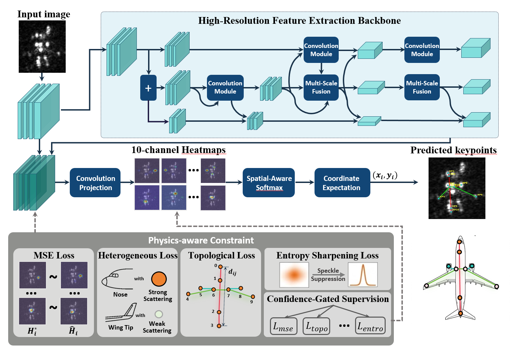

# S³U-SAR

### Physics-Driven Semantic Scattering Structure Understanding of Aircraft Target in SAR Images

<p align="center">
  <strong>ISPRS Journal of Photogrammetry and Remote Sensing</strong><br>
  Yifei Yin · Xiaogang Yu · Hao Shi · Liang Chen · Wei Li
</p>

<p align="center">
  <a href="https://www.sciencedirect.com/science/article/pii/S0924271626005009"></a>
  <a href="https://v.wjx.cn/vm/Pu93u9A.aspx#"></a>
</p>

This repository accompanies [our ISPRS paper](https://www.sciencedirect.com/science/article/pii/S0924271626005009) and provides the access entry for **KP-SAR-Aircraft-1.0**, a fine-grained benchmark for semantic scattering structure understanding of SAR aircraft targets.

> **Dataset access is now available.** Click the **百度云 / Baidu Netdisk** badge above and complete the questionnaire. The **Baidu Netdisk download link and extraction code** are displayed on the questionnaire completion page.
>
> **数据集已开放申请下载。** 点击上方按钮并填写问卷，提交后即可在问卷完成页获取**百度网盘链接和提取码**。

## Contents

- [Dataset & Download](#dataset--download)
- [Overview](#overview)
- [Framework](#framework)
- [Contact](#contact)
- [Citations](#citations)

## Dataset & Download

**KP-SAR-Aircraft-1.0** supports fine-grained SAR aircraft interpretation through semantic scattering keypoints and structural annotations.

| Item | Description |
| --- | --- |
| Image source | SAR aircraft target chips from Gaofen-3 imagery |
| Keypoints | 10 semantic scattering keypoints |
| Visibility | Visibility-aware attributes |
| Structure | Physics-constrained topology definitions |
| Category | Aircraft category labels |
| Orientation | Orientation annotations |

### How to download

1. Open the [dataset access questionnaire](https://v.wjx.cn/vm/Pu93u9A.aspx#).
2. Complete and submit the questionnaire.
3. Copy the **Baidu Netdisk link and extraction code** shown on the completion page, then download the dataset.

**[申请下载数据集 / Request Dataset →](https://v.wjx.cn/vm/Pu93u9A.aspx#)**

The dataset is distributed through Baidu Netdisk. Download information is provided after questionnaire submission.

## Overview

Synthetic aperture radar (SAR) aircraft targets appear as sparse, discontinuous scattering responses. S³U-SAR organizes these responses into a representation with explicit physical semantics and a stable structural topology.

The framework combines:

- **Semantic scattering keypoints** that associate local electromagnetic responses with meaningful aircraft components.
- **Visibility-aware attributes** that distinguish scattering-salient, scattering-degraded, and semantically invalid responses.
- **Physics-constrained topology** that organizes keypoints into a rigid-body structure.
- **Physics-guided supervision** that incorporates scattering heterogeneity, rigid-body topology, speckle uncertainty, and confidence-gated optimization.

## Framework

<p align="center">
  
</p>

## Contact

**Yifei Yin**  
Beijing Institute of Technology  
Email: [513843129@qq.com](mailto:513843129@qq.com)

For questions about the paper, dataset, or benchmark, please email us or [open an issue](https://github.com/YYF121/S3U-SAR/issues).

## Citations

If you use S³U-SAR or KP-SAR-Aircraft-1.0 in your research, please cite our paper:

Yifei Yin, Xiaogang Yu, Hao Shi, Liang Chen, and Wei Li. “Physics-driven semantic scattering structure understanding of aircraft target in SAR images.” *ISPRS Journal of Photogrammetry and Remote Sensing*, 243, Part 1, 226–242, 2027. [https://doi.org/10.1016/j.isprsjprs.2026.10.003](https://doi.org/10.1016/j.isprsjprs.2026.10.003).

```bibtex
@article{yin2027s3usar,
  title   = {Physics-driven semantic scattering structure understanding of aircraft target in {SAR} images},
  author  = {Yin, Yifei and Yu, Xiaogang and Shi, Hao and Chen, Liang and Li, Wei},
  journal = {ISPRS Journal of Photogrammetry and Remote Sensing},
  volume  = {243},
  pages   = {226--242},
  year    = {2027},
  doi     = {10.1016/j.isprsjprs.2026.10.003},
  url     = {https://www.sciencedirect.com/science/article/pii/S0924271626005009}
}
```
