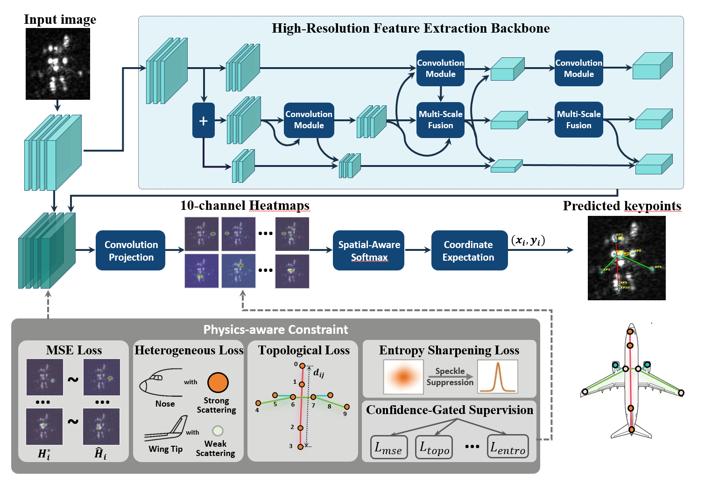

# S³U-SAR

### Physics-Driven Semantic Scattering Structure Understanding of Aircraft Target in SAR Images

<p align="center">
  <strong>ISPRS Journal of Photogrammetry and Remote Sensing</strong><br>
  Yifei Yin · Xiaogang Yu · Hao Shi · Liang Chen · Wei Li
</p>

<p align="center">
  <a href="https://www.sciencedirect.com/science/article/pii/S0924271626005009"></a>
  &nbsp;
  <a href="https://v.wjx.cn/vm/Pu93u9A.aspx#"></a>
</p>

<p align="center">
  <a href="README.md">English</a> | 简体中文
</p>

本仓库为 [S³U-SAR 论文](https://www.sciencedirect.com/science/article/pii/S0924271626005009)的官方仓库，提供 **KP-SAR-Aircraft-1.0** 数据集的获取入口。该数据集面向 SAR 飞机目标的细粒度语义散射结构理解。

> **数据集已开放申请下载。** 点击上方“申请下载数据集”按钮，填写并提交问卷后，即可在问卷完成页获取**百度网盘下载链接和提取码**。

## 目录

- [数据集与下载](#数据集与下载)
- [方法简介](#方法简介)
- [框架](#框架)
- [资源发布状态](#资源发布状态)
- [联系方式](#联系方式)
- [Citations](#citations)

## 数据集与下载

**KP-SAR-Aircraft-1.0** 提供 SAR 飞机目标切片及语义散射结构标注。

| 项目 | 说明 |
| --- | --- |
| 图像来源 | 高分三号（Gaofen-3）SAR 影像中的飞机目标切片 |
| 关键点 | 10 个语义散射关键点 |
| 可见性 | 可见性感知属性标注 |
| 结构 | 物理约束的拓扑定义 |
| 类别 | 飞机类别标签 |
| 朝向 | 方向标注 |

### 下载步骤

1. 点击下方按钮，进入问卷星数据集申请页面。
2. 填写并提交问卷。
3. 在问卷完成页复制**百度网盘下载链接和提取码**，前往网盘下载数据集。

**[申请下载数据集 →](https://v.wjx.cn/vm/Pu93u9A.aspx#)**

数据集通过百度网盘分发，下载信息在问卷提交后展示。

## 方法简介

SAR 飞机目标通常表现为稀疏、不连续的散射响应。S³U-SAR 将局部电磁响应关联到具有物理语义的飞机部件，并通过拓扑约束构建稳定的语义散射结构。

主要内容包括：

- **语义散射关键点**：建立局部散射响应与飞机物理部件之间的对应关系。
- **可见性感知属性**：区分散射显著、散射退化以及语义无效的响应。
- **物理约束拓扑**：将关键点组织为具有刚体结构约束的拓扑。
- **物理引导监督**：结合散射异质性、刚体拓扑、斑点不确定性与置信度门控优化。

## 框架

<p align="center">
  
</p>

## 资源发布状态

| 资源 | 状态 |
| --- | --- |
| 论文 | [ISPRS / ScienceDirect 正式页面](https://www.sciencedirect.com/science/article/pii/S0924271626005009) |
| KP-SAR-Aircraft-1.0 数据集 | [填写问卷后获取下载信息](https://v.wjx.cn/vm/Pu93u9A.aspx#) |
| 代码 | 尚未发布 |
| 预训练模型 | 尚未发布 |

## 联系方式

**Yifei Yin**  
北京理工大学  
邮箱：[513843129@qq.com](mailto:513843129@qq.com)

如对论文、数据集或评测有疑问，欢迎通过邮件联系，或在仓库中[提交 Issue](https://github.com/YYF121/S3U-SAR/issues)。

## Citations

如果本论文或 KP-SAR-Aircraft-1.0 数据集对你的研究有所帮助，请引用以下 ISPRS 论文：

Yifei Yin, Xiaogang Yu, Hao Shi, Liang Chen, and Wei Li. “Physics-driven semantic scattering structure understanding of aircraft target in SAR images.” *ISPRS Journal of Photogrammetry and Remote Sensing*, 243, Part 1, 226–242, 2027. [https://doi.org/10.1016/j.isprsjprs.2026.10.003](https://doi.org/10.1016/j.isprsjprs.2026.10.003).

```bibtex
@article{yin2027s3usar,
  title   = {Physics-driven semantic scattering structure understanding of aircraft target in {SAR} images},
  author  = {Yin, Yifei and Yu, Xiaogang and Shi, Hao and Chen, Liang and Li, Wei},
  journal = {ISPRS Journal of Photogrammetry and Remote Sensing},
  volume  = {243},
  pages   = {226--242},
  year    = {2027},
  doi     = {10.1016/j.isprsjprs.2026.10.003},
  url     = {https://www.sciencedirect.com/science/article/pii/S0924271626005009}
}
```
